<div align="center">

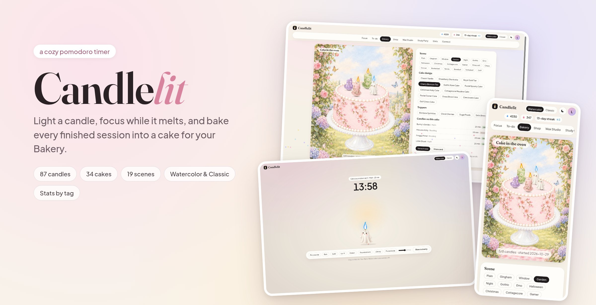

<h1>🕯️ Candlelit</h1>

<p><b>A cozy Pomodoro timer where your candle melts while you focus,<br>and every finished session goes onto a cake you get to keep.</b></p>

<p>
<a href="https://candle-lit-ten.vercel.app"><b>✨ Try it live</b></a> ·
<a href="#-features">Features</a> ·
<a href="#-how-it-works">How it works</a> ·
<a href="#-run-it-yourself">Run it yourself</a>
</p>

<p>


</p>

</div>

---

## 🌸 The idea

Think *Forest*, but with candles and cake.

You light a candle and start a Pomodoro. The candle slowly melts as the timer runs. Finish the session and the candle goes onto **today's cake**. Blow it out early and only a half-melted stub ends up there.

The cake stays hidden while you work. You only see it once the timer ends, so there's always a little reveal waiting. Full cakes go to your **Bakery**, a growing shelf of everything you've studied.

<table>
<tr>
<td width="33%">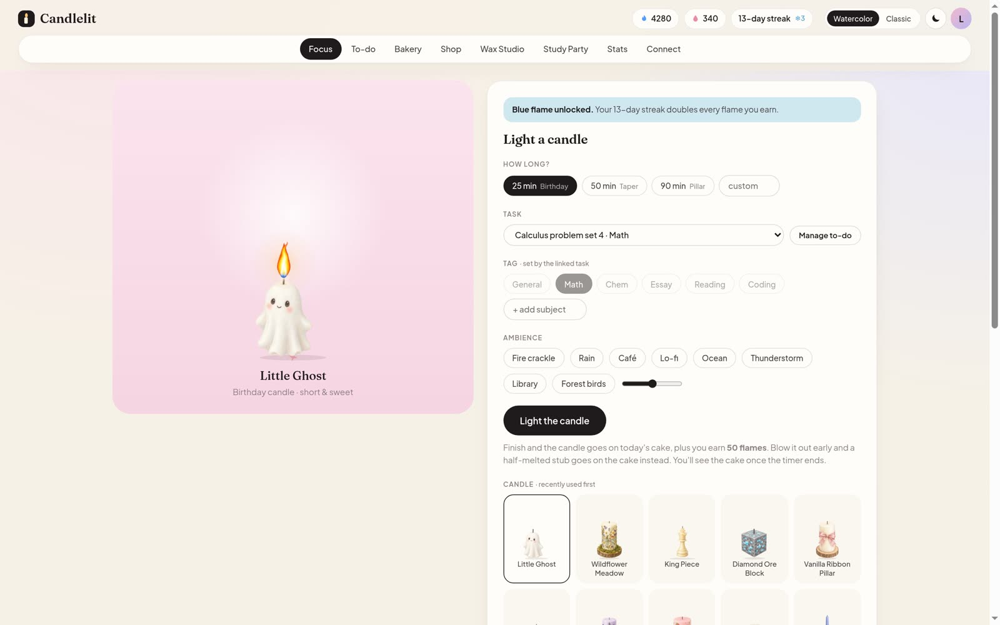</td>
<td width="33%">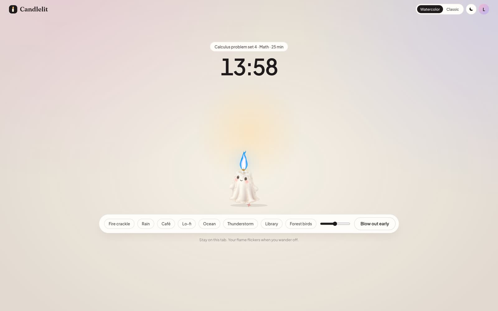</td>
<td width="33%">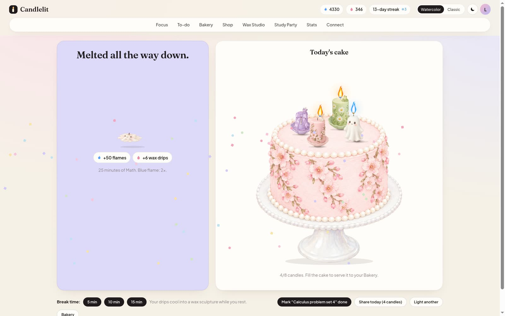</td>
</tr>
<tr>
<td align="center"><sub><b>1. Light</b><br>pick a task, a tag and a candle</sub></td>
<td align="center"><sub><b>2. Focus</b><br>the candle melts until the timer ends</sub></td>
<td align="center"><sub><b>3. Bake</b><br>it joins today's cake</sub></td>
</tr>
</table>

---

## ✨ Features

### 🕯️ Candles that actually melt
- **87 candles** in themed collections: Faerie, Mermaid, Carved, Figurines, Gothic, Emo, Halloween, Christmas, Cottagecore, Gamer, Minecraft, Chess and seven sports.
- In Watercolor mode each candle is painted in six melt stages, so it really drips and shrinks as you work.
- **25 / 50 / 90 minute** sessions (birthday candle, taper, pillar), or any custom length.
- Your flame flickers if you wander off to another tab.

### 🎂 A Bakery full of cakes
- **34 cakes** and **7 toppers** to decorate with.
- **19 painted scenes** to set your cake in, from a rose garden and a gingham picnic to a haunted night and a Minecraft meadow.
- Tap any served cake to see its study log: which candle, which subject, how long.

<p align="center">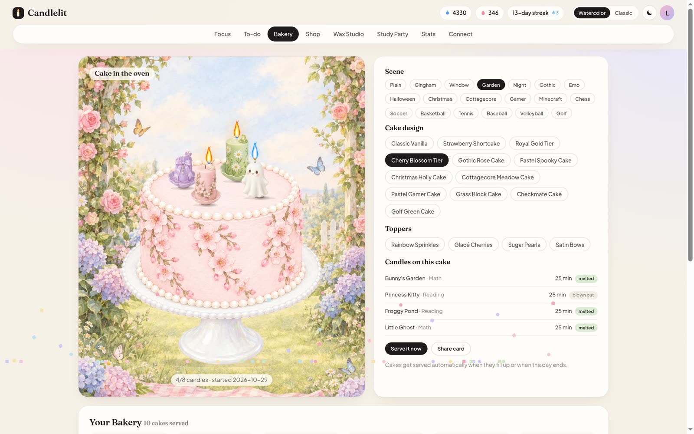 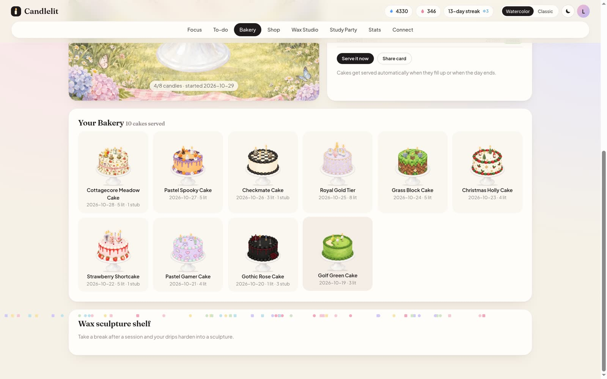</p>

### 💌 Share cards
Turn any cake into a card ("I studied 5 candles today") with the scene behind it. Download it as a PNG for your story or your X timeline.

<p align="center">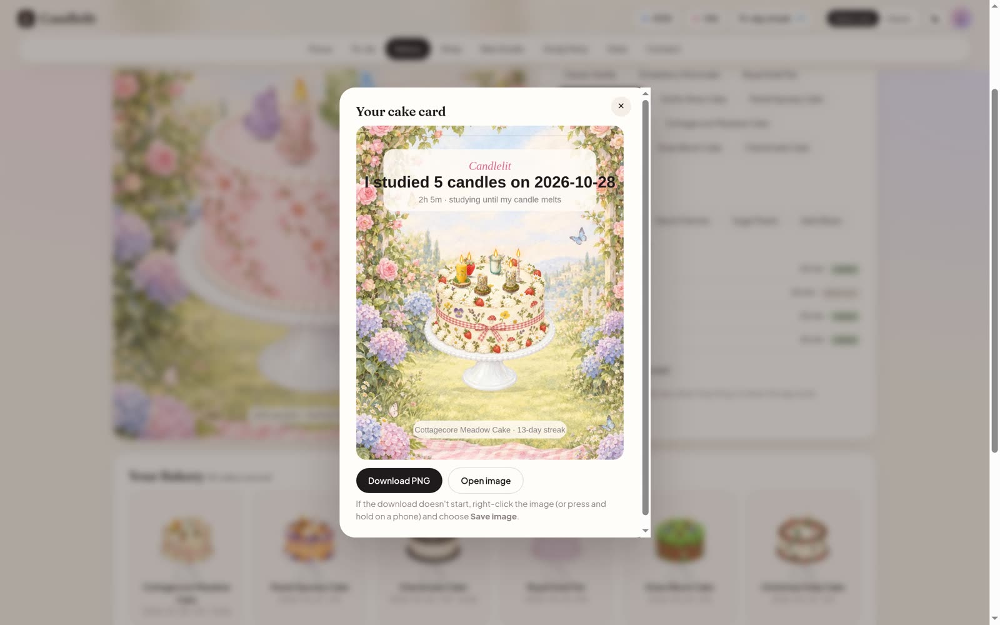</p>

### 🛍️ Shop and 🎨 Wax Studio
- Every finished session earns **flames** 🔥, which you spend in the shop on candles, cakes and toppers.
- Breaks and sessions earn **wax drips** 💧, which you pour into your own candle in the Wax Studio: three colours, a candle shape, a holder, a pattern and an engraving.
- Keep a 7-day streak and your flame turns **blue**, worth 2× flames. Streak freezes cover the days you miss.

<p align="center">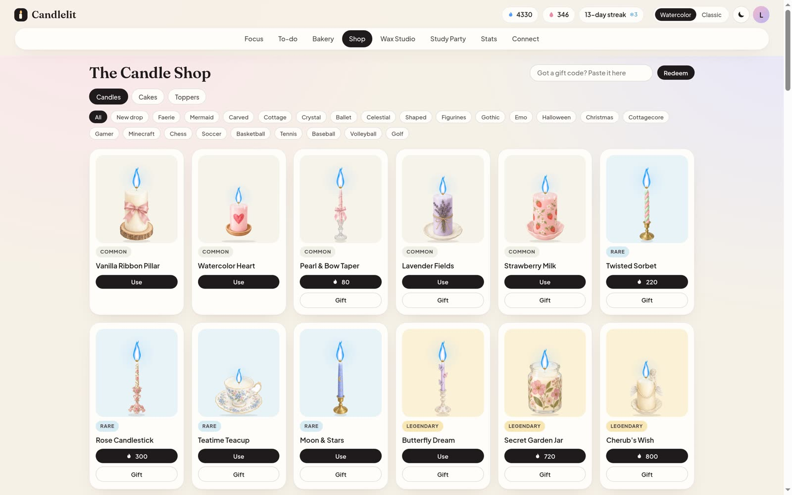 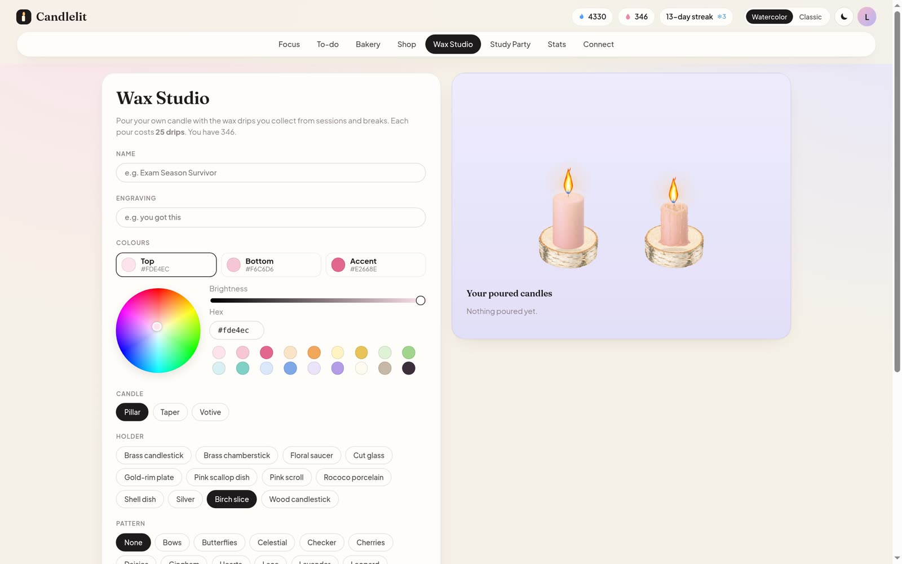</p>

### ✅ Tasks and 📊 stats
- A to-do list where every task has a **tag** (Math, Chem, Essay, …) and a Pomodoro estimate. Link a task to your session and it counts up on its own.
- Weekly, monthly and yearly stats: focus time, completion rate, time per tag, when in the day you focus best, trends and weekly goals.
- **Export CSV** with one row per session.
- If you delete a tag, its history stays in your stats.

<p align="center">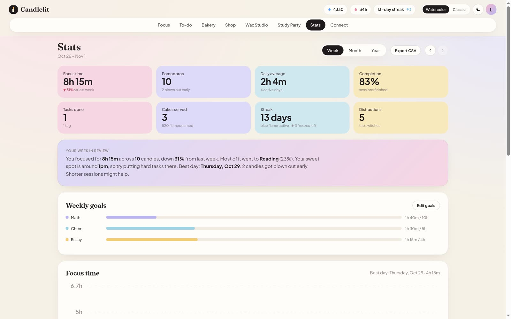 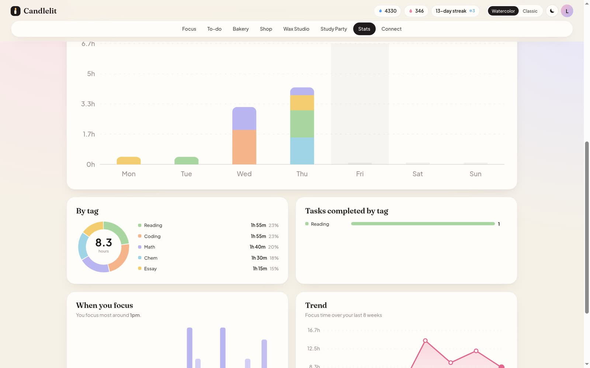</p>

### 🖌️ Two art styles: Watercolor and Classic
Switch any time from the top bar. **Watercolor** uses hand-painted candles, cakes and scenes. **Classic** draws everything as crisp illustrated SVGs.

<p align="center"> 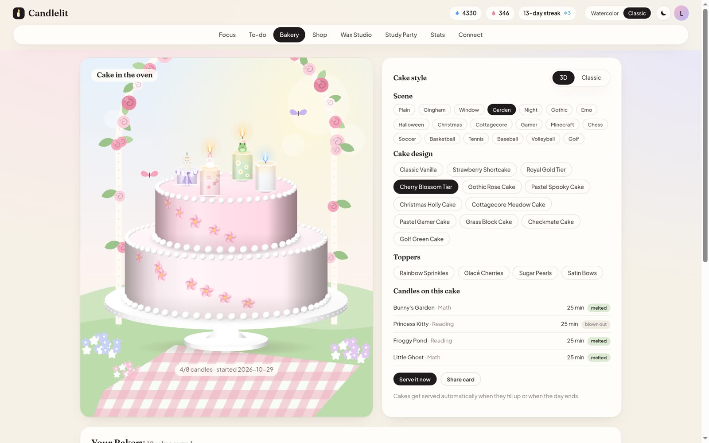</p>

### 🌙 Dark mode, sounds and every screen size
- Light and dark themes.
- Eight real ambience recordings: fire crackle, rain, café, lo-fi, ocean, thunderstorm, library and forest birds.
- Works on phones, tablets and laptops.

<p align="center">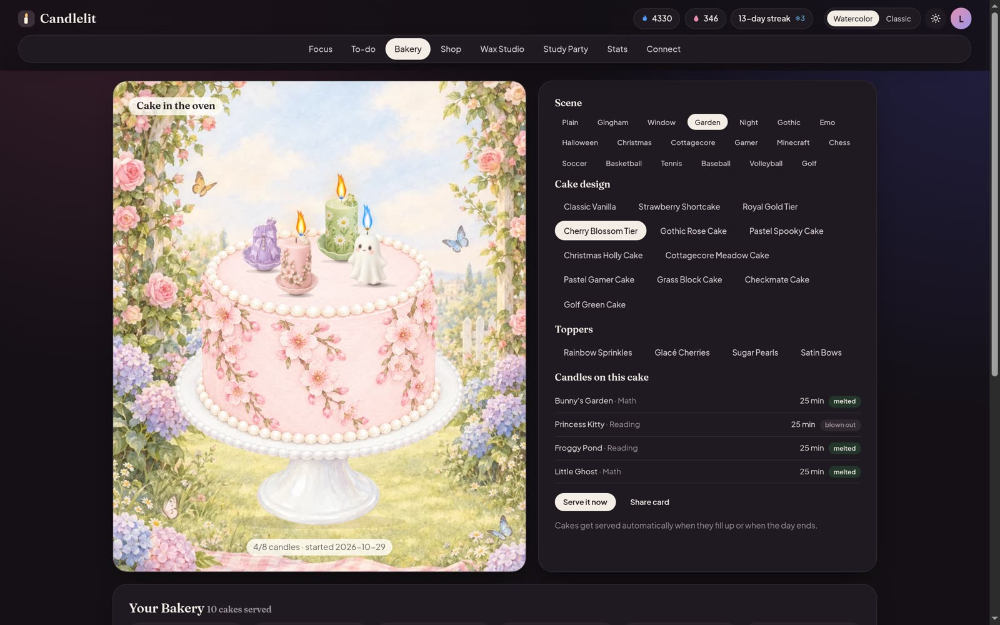 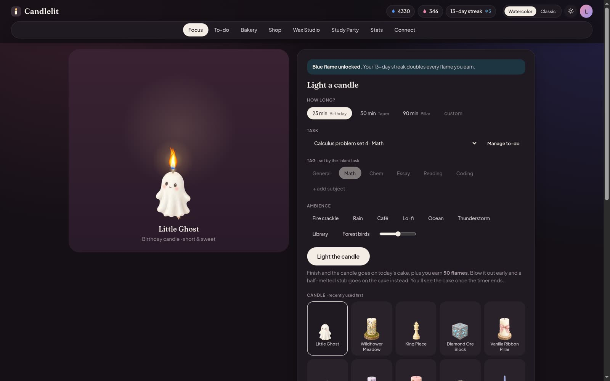</p>
<p align="center">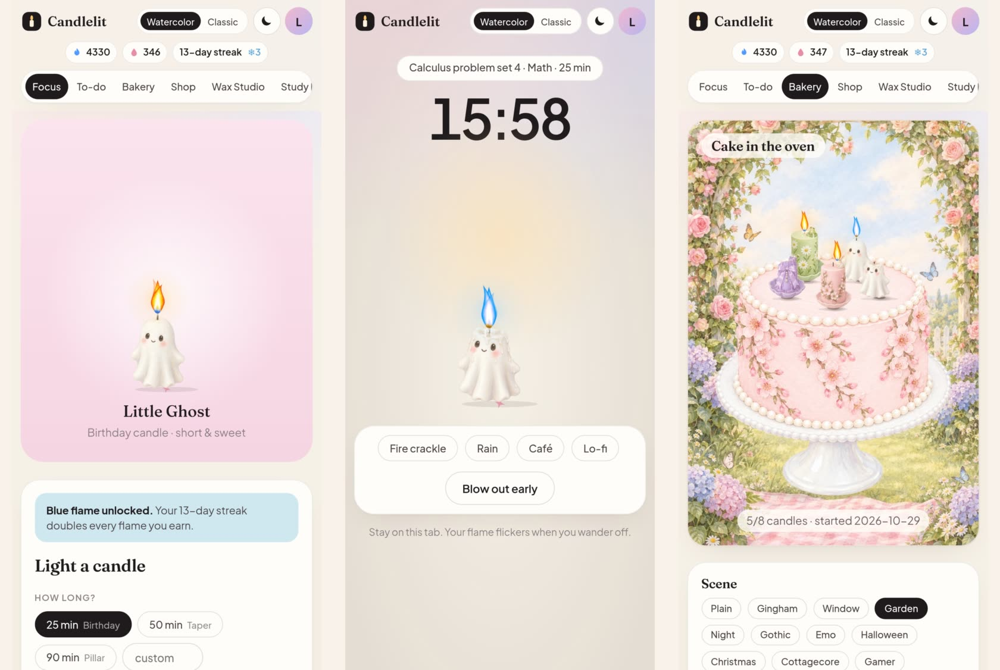</p>

### 👤 Accounts
Sign up with an email and password, and your candles, cakes and stats follow you to any device. You can also try it as a guest, with progress saved in your browser.

### 🎉 Coming soon: Study Party
Light candles with friends, watch them burn together, then blow them out at the same time for a shared party cake.

---

## 🔥 How it works

```
 light a candle ──► focus (candle melts) ──► timer ends ──► cake reveal
        ▲                                                       │
        │                   flames 🔥 + wax drips 💧            ▼
   shop / wax studio ◄──────────────────────────────── candle joins today's cake
                                                                │
                                         8 candles or end of day ▼
                                                         cake served to your Bakery
```

| | |
|---|---|
| **Frontend** | Plain HTML, CSS and JavaScript (ES modules). No framework and no build step. |
| **Art** | Painted WebP artwork for Watercolor mode, generated SVG for Classic mode |
| **Backend** | One small Python server (`server.py`) for accounts and saved progress |
| **Database** | SQLite when run locally, Neon Postgres on Vercel |
| **Hosting** | Vercel: static files plus one Python function (`api/index.py`) |

```
├── index.html         app shell
├── css/style.css      all styles (light/dark, responsive)
├── js/
│   ├── app.js         views: focus, bakery, shop, studio, stats, to-do
│   ├── data.js        catalog of candles, cakes, toppers
│   ├── render.js      Classic SVG candles and cakes
│   ├── art*.js        Watercolor art wiring
│   ├── scenes.js      Bakery and share-card scenes
│   ├── stats.js       charts
│   └── store.js       state, cakes, streaks
├── art*/              painted artwork (WebP)
├── audio/             ambience recordings (see CREDITS)
├── server.py          accounts + state API (SQLite or Postgres)
└── api/index.py       Vercel entrypoint
```

---

## 🛠️ Run it yourself

**Locally.** You only need Python 3:

```bash
python3 server.py
# open http://localhost:8080
```

Accounts are saved in `data/candlelit.db` (SQLite).

**On Vercel:**
1. Fork this repo and import it in Vercel (**Add New → Project**, preset **Other**).
2. In the project, open **Storage → Create Database → Neon** (free plan) and connect it to Production and Preview.
   The app reads `DATABASE_URL`, `POSTGRES_URL` or `STORAGE_URL`, and creates its tables on first run.
3. Redeploy.

To move local accounts into Neon:

```bash
pip install "psycopg[binary]"
DATABASE_URL="<your Neon connection string>" python3 tools/migrate_to_postgres.py
```

---

## 💛 Credits

Ambience recordings come from Wikimedia Commons under CC BY / CC BY-SA / public domain licences. See [`audio/CREDITS.txt`](audio/CREDITS.txt) for each author and licence.

<div align="center">

### Made with 🕯️ by Lyra

[GitHub](https://github.com/Lyra-4leafclover) · [X](https://x.com/Lyra_void) · [Portfolio](https://lyradossier.vercel.app/)

<sub>If Candlelit helped you focus, leave a ⭐. It keeps the flame going.</sub>

</div>
